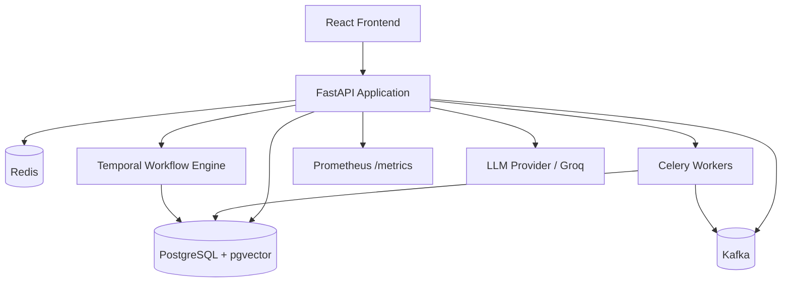

# System Architecture

SmartHealth is a healthcare scheduling and clinical operations dashboard built as a modular FastAPI backend with a React frontend. The system is organized into layered domains with clear boundaries between API, service, repository, and workflow concerns.

## System Overview

The platform manages patient booking, provider and service management, appointment lifecycle tracking, slot publishing and reservation, billing pre-checks, notifications, analytics, and an AI-powered healthcare assistant. Asynchronous workflows are orchestrated through Temporal, Celery, and Kafka.

## High-Level Components



## Layered Architecture

### API Layer (`app/api/v1/endpoints/`)

HTTP request handling, routing, authentication, and response generation. Routes are versioned under `/api/v1` and organized by domain:

| Module | Responsibility |
|--------|---------------|
| `auth.py` | User registration, login, token management |
| `patients.py` | Patient profiles and demographics |
| `providers.py` | Provider profiles and schedules |
| `departments.py` | Department catalog |
| `services.py` | Service offerings and publishing |
| `slots.py` | Availability slots and reservations |
| `appointments.py` | Booking, cancellation, rescheduling, visit tracking |
| `analytics.py` | Operational analytics and metrics |
| `reports.py` | Generated reports and data exports |
| `tasks.py` | Background task status |
| `search_enhanced.py` | Semantic service search |
| `assistant.py` | AI healthcare assistant |
| `notifications.py` | User notifications |
| `health.py` | Health checks |
| `metrics.py` | Prometheus metrics |
| `public.py` | Public catalog endpoints (no auth) |

### Service Layer (`app/services/`)

Business logic and workflow orchestration. Key services:

- `appointment_service.py` — appointment booking lifecycle
- `appointment_saga_service.py` — saga orchestration for booking
- `auth_service.py` — authentication business logic
- `communication_service.py` — notification and reminder delivery
- `embedding_service.py` — vector embeddings for semantic search
- `hybrid_search_service.py` — hybrid keyword + vector search
- `llm_provider.py` — LLM abstraction (Groq/OpenAI)
- `safety_service.py` — medical advice refusal and PHI scoping
- `service_management.py` / `service_publish_service.py` — service publishing workflow
- `slot_service.py` — slot availability and reservation
- `healthcare_event_service.py` — event publishing
- `analytics_service.py` — analytics computation

### Repository Layer (`app/repositories/`)

Persistence and data access using SQLAlchemy ORM. One repository per domain entity:

- `appointments.py`, `patients.py`, `providers.py`, `departments.py`
- `services.py`, `slots.py`, `billing.py`, `notifications.py`
- `analytics.py`, `content_chunks.py`, `outbox.py`, `failed_jobs.py`
- `auth.py`, `health.py`, `base.py`

### Schema Layer (`app/schemas/`)

Pydantic request/response validation:

- `domain.py` — core domain schemas
- `user.py` — user authentication schemas
- `assistant.py` — AI assistant request/response
- `billing.py` — billing schemas
- `search.py` — search request/response

### Model Layer (`app/models/`)

SQLAlchemy ORM models representing database tables:

- `User`, `UserRole` — users and roles (patient, provider, front_desk, admin)
- `Patient`, `Provider`, `Department`, `Service`, `ServiceStatus`
- `Slot`, `SlotStatus`, `SlotReservation`, `SlotReservationStatus`
- `Appointment`, `AppointmentStatus`, `AppointmentStatusHistory`, `VisitStatus`
- `Visit`, `Billing`, `BillingStatus`
- `Notification`, `NotificationStatus`, `WaitlistEntry`, `WaitlistStatus`
- `IdempotencyKey` — idempotency for safe retries
- `AuditLog` — audit trail
- `OutboxEvent`, `ProcessedEvent` — event sourcing
- `ContentChunk`, `AIInteraction`, `GeneratedContent` — AI/search features
- `AnalyticsDaily`, `AnalyticsAppointmentDaily`, `AnalyticsServiceDaily`, `AnalyticsProcessedEvent`
- `FailedJob`

### Workflow Layer (`app/workers/temporal/`)

Temporal-based workflow orchestration for multi-step sagas:

- `workflows/appointment_saga.py` — appointment booking saga with compensation
- `workflows/service_publish.py` — service publishing workflow
- `activities/appointment_saga.py` — saga activities
- `activities/scheduling_activities.py`, `billing_activities.py`, `notification_activities.py`, `service_publish.py`
- `runtime/appointment_booking.py`, `runtime/service_publish.py`

### Background Workers (`app/workers/`)

- Celery (`app/workers/celery/`) — reminder tasks, analytics, outbox processing
- Kafka (`app/workers/kafka/`) — event consumer/producer for analytics
- Redis (`app/workers/redis/`) — idempotency and shared state configuration

### Observability Layer

- `app/core/middleware.py` — CorrelationIdMiddleware for request tracing
- `app/core/http_metrics_middleware.py` — HTTP metrics collection
- `app/core/metrics.py` — Prometheus metrics and counters
- `app/core/logging.py` — structured JSON logging
- `app/core/security_headers.py` — security headers middleware
- `app/core/sse.py` — server-sent events

## Data Flow

1. **Client request** → React frontend calls FastAPI endpoint
2. **Authentication** → JWT validation, role-based authorization
3. **Business logic** → Service layer validates and orchestrates
4. **Persistence** → Repository layer writes to PostgreSQL
5. **Async processing** → Celery tasks and Temporal workflows for reminders, bookings, service publishing
6. **Event streaming** → Kafka publishes domain events with PHI sanitization
7. **Observability** → Structured logs, correlation IDs, Prometheus metrics

## Key Design Decisions

- **Idempotency**: Redis-backed `Idempotency-Key` header prevents duplicate booking requests
- **Saga pattern**: Temporal workflows handle multi-step booking with compensation on failure
- **PHI scoping**: AI assistant responses are sanitized to prevent medical diagnosis/treatment advice
- **Degraded mode**: Kafka unavailable at startup does not block API startup
- **Dual env loading**: `.env` then `.env.production` for local/production configuration

## Technology Stack

| Layer | Technology |
|-------|-----------|
| API framework | FastAPI 0.115.6 |
| ASGI server | Uvicorn 0.32.1 |
| ORM | SQLAlchemy 2.0.36 |
| Database | PostgreSQL 16 + pgvector |
| Migrations | Alembic 1.14.0 |
| Cache / idempotency | Redis 7 |
| Background jobs | Celery 5.5.3 |
| Event streaming | Kafka 7.5.0 |
| Workflow orchestration | Temporal 1.31.0 |
| LLM provider | Groq / OpenAI |
| Embeddings | HuggingFace (pgvector) |
| Monitoring | Prometheus |
| Containerization | Docker / Docker Compose |
| Frontend | React + Vite + Tailwind CSS |

## Directory Structure

```
backend/
  app/
    api/v1/endpoints/    # HTTP route handlers
    core/                # Settings, middleware, security, logging, metrics
    db/                  # Database session and engine
    models/              # SQLAlchemy ORM models
    repositories/        # Data access layer
    schemas/             # Pydantic validation schemas
    services/            # Business logic layer
    workers/             # Celery, Kafka, Temporal workers
  alembic/versions/      # Database migrations
  tests/                 # Unit and integration tests
  scripts/               # Seed and utility scripts
  docker-compose.yml     # Multi-service orchestration
  Dockerfile             # API container image
  requirements.txt       # Python dependencies

frontend/
  src/
    components/          # Reusable UI components
    views/               # Role-based dashboard views
    api.js               # API client
    App.jsx              # Application entry
```
